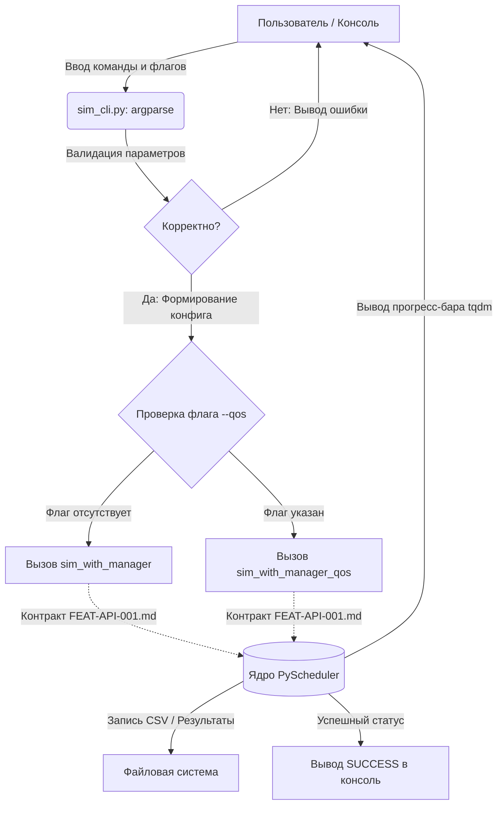

# ОТЧЕТ О ПРОДЕЛАННОЙ РАБОТЕ №5

**Тема:** Архитектурный аудит UI-системы симулятора, категоризация компонентов и проектирование пользовательского пути CLI  
**Исполнитель:** Студент 2 курса Бойченко Вероника Алексеевна, группа ИКС-531  
**Репозиторий:** `ui-system`  
**Технологический стек:** React 18+, Vite 7, Tailwind CSS 4, Axios, REST API.  

---

## 1. Что было сделано и изучено за неделю

За отчетный период был проведен комплексный архитектурный аудит текущей кодовой базы интерфейса симулятора, категоризированы ключевые компоненты и спроектирован сквозной пользовательский путь для интеграции CLI-модуля.

* **Аудит и рефакторинг документации:** Проделана большая аналитическая работа по унификации проектных требований. **4 разрозненных файла исходной документации и черновых заметок были успешно преобразованы и консолидированы в 1 единый структурированный файл спецификации SPEC-CLI-001.md**, полностью описывающий логику работы консольного интерфейса.
* **Изучение технологического стека:** Проанализирована конфигурация сборщика Vite 7 и особенности стилизации UI-компонентов с использованием новой версии Tailwind CSS 4. Проверена совместимость дерева компонентов с React 18+.
* **Проектирование сетевого взаимодействия:** Изучены механизмы выполнения асинхронных запросов через Axios к REST API бэкенда PyScheduler. Определены точки интеграции, где параметры, собранные через консоль или веб-интерфейс, транслируются в HTTP-запросы к серверу симуляции.
* **Анализ логики бэкенда:** Проведена проверка работоспособности ядра симулятора внутри WSL через ручной запуск `TEST_MODULES.py`. Успешно протестирован вывод прогресс-бара `tqdm` до 100%. Из функций `sim_with_manager` и `sim_with_manager_qos` выделены захардкоженные параметры (длительность, пользователи, алгоритмы), которые перенесены в интерфейс управления.

---

## 2. Консолидированная спецификация CLI (Документ SPEC-CLI-001.md)

В результате слияния и переработки 4 файлов документации был сформирован итоговый план реализации, который будет размещен в репозитории по пути `cli/docs/specs/SPEC-CLI-001.md`.

Ниже представлен полный текст консолидированной спецификации:

```markdown
# SPEC-CLI-001: Спецификация консольного интерфейса (CLI) для PyScheduler

**Идентификатор фичи:** FEAT-CLI-001  
**Автор:** Бойченко Вероника (группа ИКС-531)  
**Статус:** На согласовании  

---

## 1. Назначение
Консольный интерфейс (CLI) предназначен для гибкого управления модулем `PyScheduler` без необходимости ручной правки исходного кода. Утилита позволяет конечным пользователям и автоматизированным скриптам запускать симуляции планировщика с кастомными параметрами (длительность, количество пользователей, тип алгоритма) напрямую из терминала. CLI выступает в роли изолированной обёртки над бэкендом, автоматизируя сбор параметров и вызов функций ядра.

---

## 2. Требования
Разрабатываемый интерфейс командной строки должен обладать следующей функциональностью:
* **Параметризация запуска:** Возможность передавать длительность симуляции, количество пользователей и тип алгоритма через флаги командной строки.
* **Динамический выбор режима:** Переключение между стандартной симуляцией (`sim_with_manager`) и режимом качества обслуживания (`sim_with_manager_qos`) с помощью флага-переключателя.
* **Автоматическая справка:** Поддержка флагов `-h` и `--help` с выводом актуальной информации по всем доступным командам и аргументам.
* **Валидация данных:** Предварительная проверка вводимых пользователем значений (например, проверка на положительные числа) до передачи данных в ядро.
* **Индикация процесса:** Отображение прогресс-бара симуляции в реальном времени (интеграция с библиотекой `tqdm`).
* **Логирование:** Вывод информационных сообщений (`[INFO]`, `[SUCCESS]`, `[ERROR]`) на этапах парсинга, конфигурации и завершения работы.

---

## 3. Архитектура
Интерфейс CLI реализуется в файле `sim_cli.py` на базе стандартной библиотеки `argparse`. Он отделен от бизнес-логики и взаимодействует с бэкендом строго через публичный контракт, описанный Александром в документе **`FEAT-API-001.md`**.

### Схема взаимодействия CLI и API бэкенда


---

## 4. Интерфейсы (Команды и Флаги)

Базовый скрипт: `python3 sim_cli.py`  
Главная подкоманда: `run`

### Доступные флаги для `run`:
* `-d`, `--duration` (целое число) — Длительность симуляции в TTI (миллисекундах). По умолчанию: `50000`.
* `-n`, `--ue-count` (целое число) — Количество случайно генерируемых пользователей (UE). По умолчанию: `5`.
* `-s`, `--scheduler` (выбор из: `RoundRobin`, `ProportionalFair`) — Алгоритм планировщика. По умолчанию: `RoundRobin`.
* `--qos` (флаг) — Переключатель режима. При указании активирует QoS-трафик.

### Примеры вызова:

1. **Просмотр встроенной справки:**
   ```bash
   python3 sim_cli.py run --help
   ```

2. **Базовый запуск с дефолтными параметрами:**
   ```bash
   python3 sim_cli.py run
   ```

3. **Кастомный запуск в QoS-режиме:**
   ```bash
   python3 sim_cli.py run --duration 5000 --scheduler ProportionalFair --ue-count 3 --qos
   ```

---

## 5. Зависимости
* **Внешние библиотеки:** `numpy`, `matplotlib`, `tqdm` (для работы ядра и прогресс-бара).
* **Системные модули:** `argparse` (встроенный в Python 3).
* **Бэкенд-модуль (Разработчик: Александр):** 
  * Публичный контракт импорта функций и сигнатуры параметров регламентируются спецификацией **`FEAT-API-001.md`**.
  * На этапах автономной разработки и тестирования CLI изолированно использует программную заглушку **`API_MODULE-001.md`** вместо реального ядра.
  ```python
  from TEST_MODULES import sim_with_manager, sim_with_manager_qos
  ```

---

## 6. Проверки (Тест-кейсы)
Для валидации работоспособности CLI на этапе демонстрации выполняются следующие сценарии:

* **Тест 1 (Справка):** `python3 sim_cli.py run --help` 
  * *Ожидаемый результат:* Отображается Usage-текст, описание всех 4-х флагов и дефолтных значений. Скрипт завершается без ошибок.
* **Тест 2 (Валидация некорректных данных):** `python3 sim_cli.py run --duration -100` или `python3 sim_cli.py run --scheduler WrongAlg`
  * *Ожидаемый результат:* CLI перехватывает ошибку, не запускает ядро, выводит в консоль понятное сообщение об ошибке валидации.
* **Тест 3 (Интеграционный запуск):** `python3 sim_cli.py run --duration 1000 --ue-count 2`
  * *Ожидаемый результат:* В консоли появляются логи `[INFO]`, запускается прогресс-бар `tqdm` (доходит до 100%), симуляция успешно завершается сообщением `[SUCCESS]`, создаются файлы статистики.

---

## 7. Этапы разработки
Разбивка реализации фичи FEAT-CLI-001 на логические спринты:

* **Этап 1:** Создание скелета `sim_cli.py`, настройка `argparse`, описание подкоманды `run`, всех флагов и авто-справки (`--help`).
* **Этап 2:** Добавление внутренней валидации типов данных (проверка на положительные значения TTI и количества UE, ограничение выбора планировщиков).
* **Этап 3:** Написание логики ветвления (выбор между `sim_with_manager` и `sim_with_manager_qos` в зависимости от флага `--qos`). Интеграция вызовов функций с использованием заглушки **`API_MODULE-001.md`** для автономной отладки интерфейса.
* **Этап 4:** Сквозная интеграция с реальным бэкендом после его готовности по контракту **`FEAT-API-001.md`**, проброс реального прогресс-бара ядра в интерфейс, обработка финальных логов.

---

## 8. Критерии готовности (Definition of Done)
CLI считается готовым к сдаче и интеграции в основной репозиторий, когда:
1. Код `sim_cli.py` написан без хардкода параметров, полностью развязан с ядром через импорты.
2. Все тест-кейсы из раздела «Проверки» успешно выполняются на локальной машине (включая среду WSL).
3. Прогресс-бар `tqdm` корректно отображается и не ломает структуру логов CLI при выводе.
4. Документ спецификации согласован внутри команды, обеспечена полная трассируемость со спецификацией API.
```
